<div align="center">

<h1>luci-theme-beautiful</h1>
<p><b>A shadcn/ui inspired theme for OpenWrt LuCI</b></p>
<p>Neutral palette · sidebar shell · light &amp; dark · no webfonts · mobile ready</p>
<p><a href="README.md">简体中文</a> · <a href="README.en.md"><b>English</b></a></p>
<p>


</p>
</div>

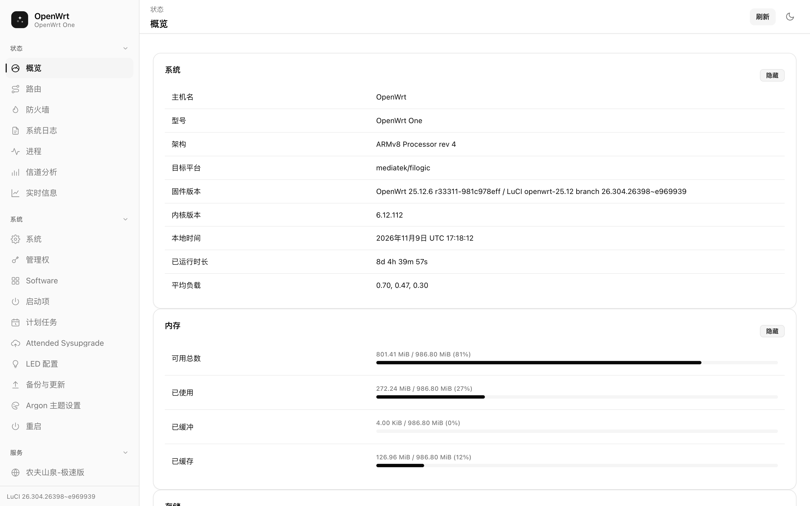

---

## Contents

- [Introduction](#introduction)
- [Screenshots](#screenshots)
- [Highlights](#highlights)
- [Installation](#installation)
  - [Prerequisites](#prerequisites)
  - [Option A: on-device installer](#option-a-on-device-installer)
  - [Option B: apk package (OpenWrt 24.10+)](#option-b-apk-package-openwrt-2410)
  - [Option C: manual deployment](#option-c-manual-deployment)
  - [Switching, rolling back, uninstalling](#switching-rolling-back-uninstalling)
  - [Troubleshooting](#troubleshooting)
- [One-prompt install with an AI agent](#one-prompt-install-with-an-ai-agent)
- [Development](#development)
- [Layout](#layout)
- [Customising](#customising)
- [Friends](#friends)
- [Copyright and license](#copyright-and-license)

---

## Introduction

`luci-theme-beautiful` is a theme for the OpenWrt **LuCI** web interface, inspired by [shadcn/ui](https://ui.shadcn.com): a restrained neutral palette, generous whitespace, a persistent sidebar, and one-click light/dark switching.

It is built on top of the **structure layer** of the official `luci-theme-bootstrap`, so every LuCI widget keeps its original behaviour — dropdowns, dynamic lists, tab groups, modals and indicators. The theme replaces appearance only; no functional logic is touched.

- No webfonts, no icon CDN — fully usable on an offline router
- Plain CSS plus a small amount of vanilla JS; no runtime dependency
- Verified on **OpenWrt 25.12 / LuCI 26.304**; the structure is the same on 23.05 and later LuCI releases that use ucode templates

## Screenshots

All screenshots come from real hardware (OpenWrt One, ARMv8), not mockups.

### Desktop

| Status · Overview (light) | Status · Overview (dark) |
| :---: | :---: |
|  | 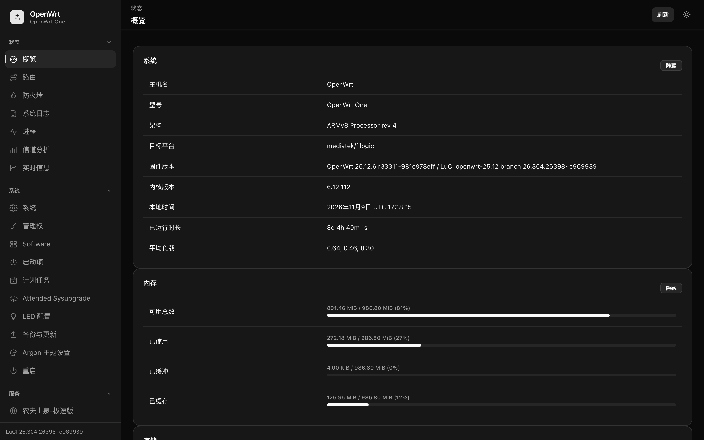 |

| System · Settings (light) | System · Settings (dark) |
| :---: | :---: |
| 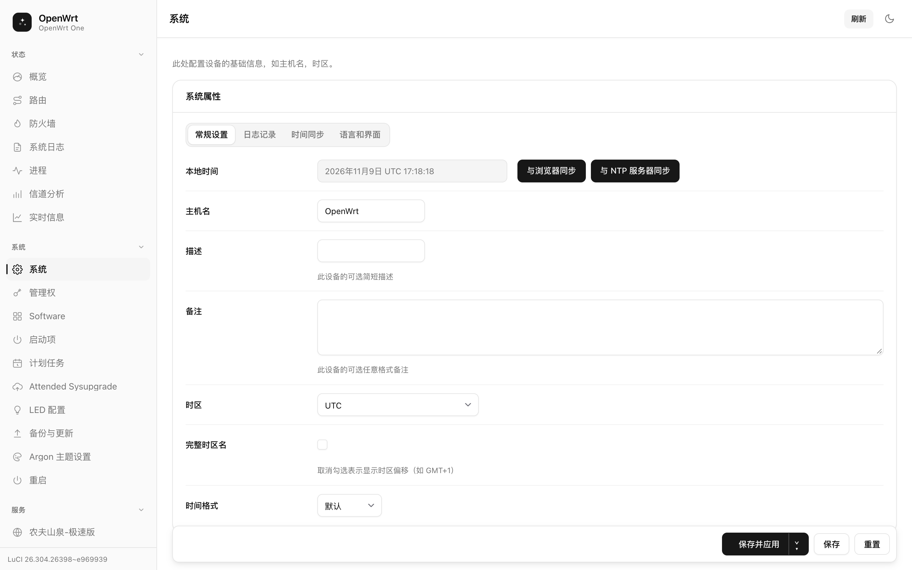 | 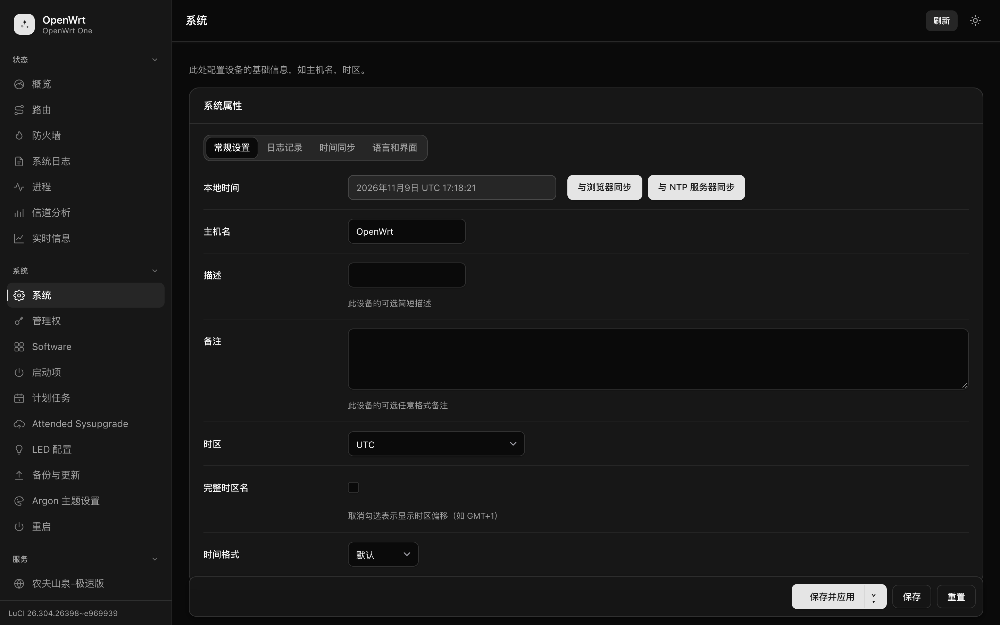 |

| System log (light) | System log (dark) |
| :---: | :---: |
| 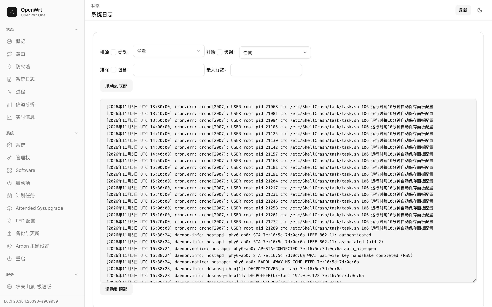 | 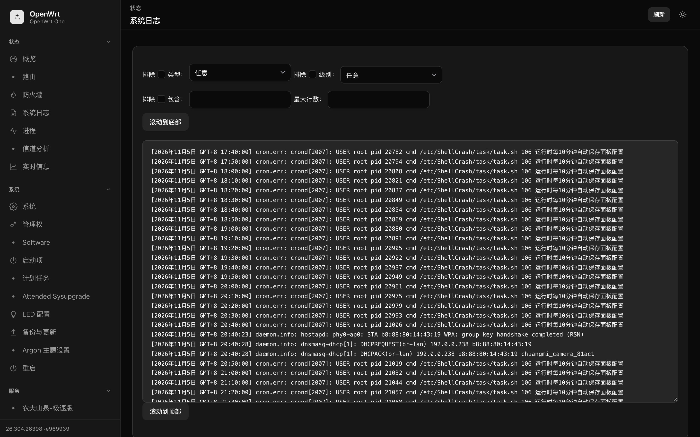 |

### Login page

| Light | Dark |
| :---: | :---: |
| 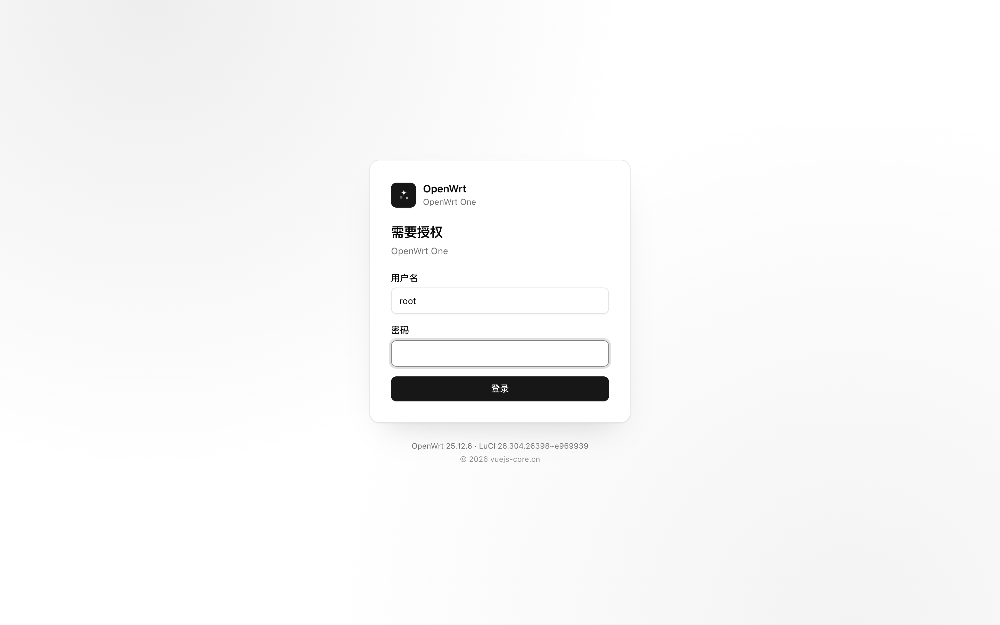 | 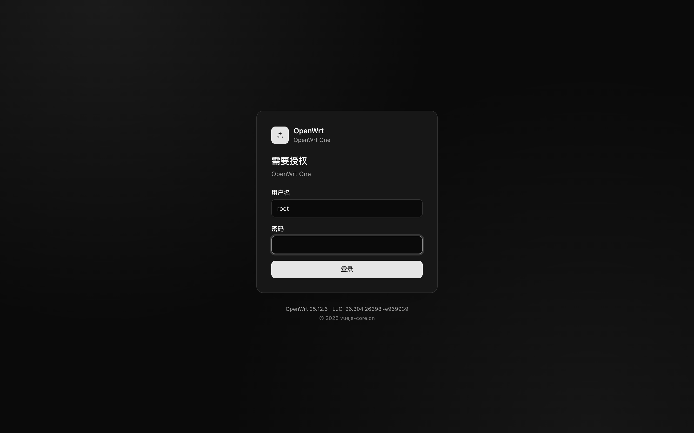 |

### Tables, destructive actions and footer

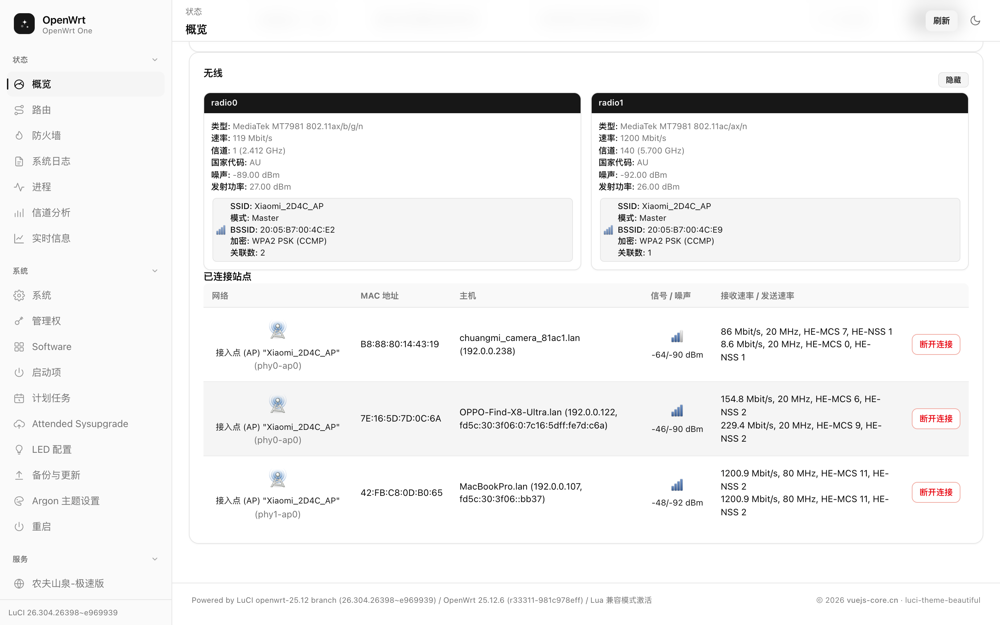

### Mobile

| Overview | Drawer menu |
| :---: | :---: |
| 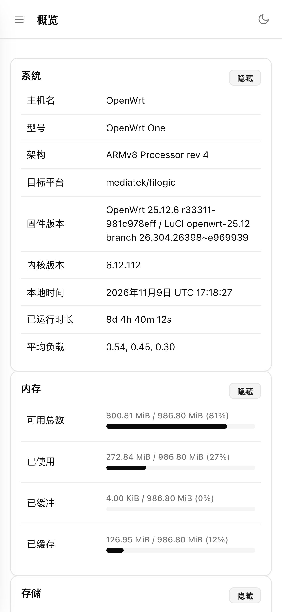 | 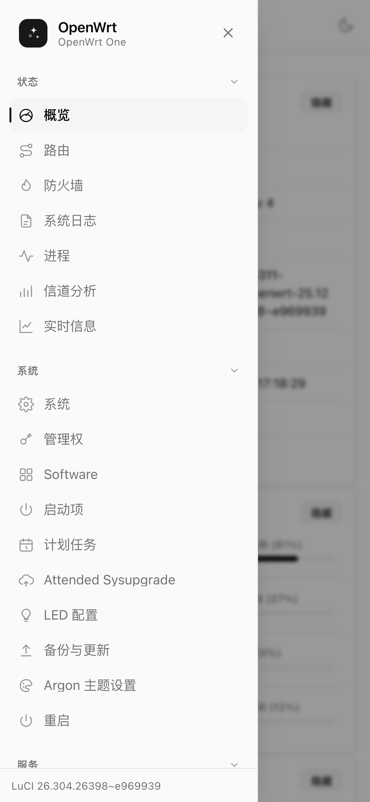 |

| Light | Dark |
| :---: | :---: |
| 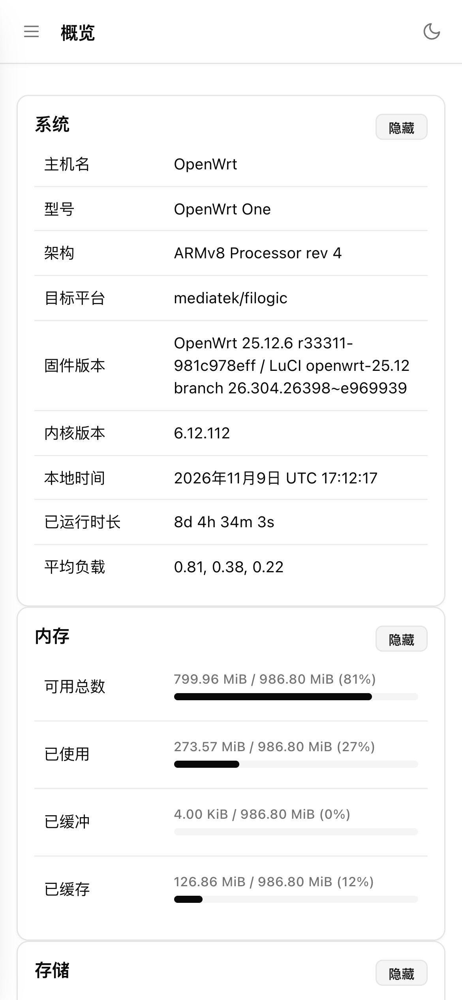 | 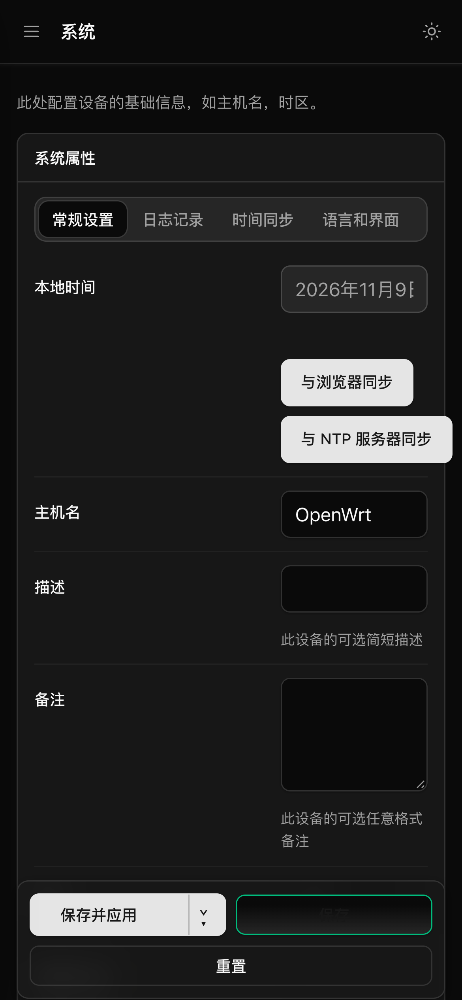 |

## Highlights

- **shadcn design tokens** — the complete `--background / --foreground / --card / --primary …` variable set in `oklch()`, mapped onto the historic `--*-color-*` variables LuCI uses. Theming stays decoupled from widget implementations.
- **Sidebar shell** — collapsible navigation groups with 24×24 line icons; a sticky top bar with breadcrumb, page title, indicators and a colour-scheme toggle (persisted in `localStorage`, falling back to `prefers-color-scheme`).
- **App-like components** — cards, segmented tabs, quiet outline buttons, destructive styling, floating action bar, progress bars, badges, alerts, dialogs.
- **Mobile ready** — the sidebar collapses into an off-canvas drawer, tables scroll horizontally, touch targets are at least 40px.
- **No webfonts** — system UI font stack: fast, offline-friendly, zero external requests.
- **Overridable** — change one `--primary` token to re-brand; no selector rewriting.

## Installation

### Prerequisites

| Item | Requirement |
| --- | --- |
| System | OpenWrt 23.05 / 24.10 / 25.x (LuCI with ucode templates) |
| Access | `root` over SSH (default `ssh root@192.168.1.1`) |
| Storage | about 200 KiB (`cascade.css` is ~150 KiB) |
| Network | Option A needs outbound access to GitHub; otherwise download locally and `scp` the archive |
| Backup | Recommended: `cp /etc/config/luci /etc/config/luci.bak` |

> `192.168.1.1` is a placeholder — substitute your own router address. The installer never reboots the router and does not require one.

### Option A: on-device installer

Works on every supported release. No opkg/apk, no build toolchain.

**Step 1 — put the archive in `/tmp`**

Download directly on the router (needs internet):

```sh
wget -O /tmp/theme.tar.gz https://github.com/zxwk1998/luci-theme-beautiful/releases/latest/download/luci-theme-beautiful-1.0.0.tar.gz
```

Or download on your computer and upload it:

```sh
scp luci-theme-beautiful-1.0.0.tar.gz root@192.168.1.1:/tmp/
```

**Step 2 — unpack and run the installer**

```sh
ssh root@192.168.1.1
cd /tmp && tar xzf theme.tar.gz
cd luci-theme-beautiful-1.0.0 && sh install.sh
```

The script performs four steps (readable line by line in `root/install.sh`):

1. Copy `cascade.css`, `mobile.css` and `logo.svg` into `/www/luci-static/beautiful/`
2. Copy `menu-beautiful.js` into `/www/luci-static/resources/` and the templates into `/usr/share/ucode/luci/template/themes/beautiful/`
3. Write UCI keys `luci.themes.Beautiful=/luci-static/beautiful` and `luci.main.mediaurlbase=/luci-static/beautiful`, then `uci commit luci`
4. Clear `/tmp/luci-indexcache*` and reload uhttpd

**Step 3 — hard-refresh the browser**

Open `http://192.168.1.1/cgi-bin/luci/` and press `Ctrl/Cmd + Shift + R`. If you still see the old look, it is browser cache — a hard refresh resolves it.

### Option B: apk package (OpenWrt 24.10+)

`apk` packages must be produced by the OpenWrt build system (Linux only). Drop this directory into `feeds/luci/themes/` and build:

```sh
# inside the OpenWrt buildroot / SDK
./scripts/feeds update -a && ./scripts/feeds install -a
make package/luci-theme-beautiful/compile V=s
ls bin/packages/*/luci/luci-theme-beautiful-*.apk
```

The included `.github/workflows/build-apk.yml` does the same on CI and uploads the artifact.

Install:

```sh
scp luci-theme-beautiful-*.apk root@192.168.1.1:/tmp/
ssh root@192.168.1.1 'apk add --allow-untrusted /tmp/luci-theme-beautiful-*.apk'
```

> The router only accepts packages signed by a key in `/etc/apk/keys`. A locally built package is signed with the build key of that SDK; for public distribution either publish the matching public key alongside the package, or install it explicitly with `--allow-untrusted`.
>
> When installed as a package, theme registration is handled by `root/etc/uci-defaults/30_luci-theme-beautiful`, which deliberately does not override an existing user selection.

### Option C: manual deployment

If you prefer not to run a script, these are the equivalent steps:

```sh
mkdir -p /www/luci-static/beautiful \
         /www/luci-static/resources \
         /usr/share/ucode/luci/template/themes/beautiful

# copy the unpacked files into the three directories above
cp -f www/luci-static/beautiful/*              /www/luci-static/beautiful/
cp -f www/luci-static/resources/menu-beautiful.js /www/luci-static/resources/
cp -f usr/share/ucode/luci/template/themes/beautiful/*.ut \
      /usr/share/ucode/luci/template/themes/beautiful/
chmod 644 /www/luci-static/beautiful/* \
          /www/luci-static/resources/menu-beautiful.js \
          /usr/share/ucode/luci/template/themes/beautiful/*

uci set luci.themes.Beautiful=/luci-static/beautiful
uci set luci.main.mediaurlbase=/luci-static/beautiful
uci commit luci

rm -f /tmp/luci-indexcache*
/etc/init.d/uhttpd reload
```

### Switching, rolling back, uninstalling

**Switch theme**: LuCI → *System → System → Language and Style*, pick `Beautiful`.

**Roll back** (keep the files, use the stock theme):

```sh
uci set luci.main.mediaurlbase=/luci-static/bootstrap
uci commit luci
rm -f /tmp/luci-indexcache* && /etc/init.d/uhttpd reload
```

**Uninstall completely**:

```sh
uci set luci.main.mediaurlbase=/luci-static/bootstrap
uci delete luci.themes.Beautiful
uci commit luci

rm -rf /www/luci-static/beautiful
rm -f  /www/luci-static/resources/menu-beautiful.js
rm -rf /usr/share/ucode/luci/template/themes/beautiful

rm -f /tmp/luci-indexcache* && /etc/init.d/uhttpd reload
```

### Troubleshooting

| Symptom | Cause and fix |
| --- | --- |
| Page renders as unstyled text | `mediaurlbase` does not point at the theme, or `cascade.css` is missing. Check `uci get luci.main.mediaurlbase` and `ls -l /www/luci-static/beautiful/` |
| Styling applied but sidebar missing | `menu-beautiful.js` was not copied into `/www/luci-static/resources/` |
| Old appearance persists | Browser cache or `/tmp/luci-indexcache*` not cleared. Hard-refresh, or repeat step 4 |
| `cascade.css` returns 404 | Directory case mismatch — Linux filesystems are case-sensitive |
| Installer prints `must run as root` | Log in as `root`; `sudo sh` will fail when `sudo` is not installed |
| Theme gone after a firmware upgrade | Files live in `/www` and `/usr/share`, which a sysupgrade resets. Re-run Option A |

## One-prompt install with an AI agent

If you would rather not type commands, hand the install to an AI assistant that can run local shell commands (Claude Code, Cursor, Codex, WorkBuddy, and similar). It will download, upload, execute and verify.

### Full prompt (recommended)

Copy the block below and edit only the IP and password on the first lines:

```text
You are an OpenWrt operations assistant. Install the luci-theme-beautiful theme on my router.

Target device:
- IP: 192.168.1.1
- User: root
- Password: <fill in here>  (if key-based login is unavailable, ask me to run ssh-copy-id first)
- System: OpenWrt — detect the exact release yourself

Follow these steps strictly. If any step fails, stop and report why. Do not skip, do not guess.

1. Detect the environment
   ssh root@192.168.1.1 'cat /etc/openwrt_release; uci get luci.main.mediaurlbase'
   Record the release and the current theme. Confirm this is OpenWrt, not another Linux.

2. Fetch the installer (try in order)
   a) Prefer the release asset:
      ssh root@192.168.1.1 'wget -O /tmp/theme.tar.gz https://github.com/zxwk1998/luci-theme-beautiful/releases/latest/download/luci-theme-beautiful-1.0.0.tar.gz'
   b) If the router cannot reach the internet, download locally and upload:
      scp luci-theme-beautiful-1.0.0.tar.gz root@192.168.1.1:/tmp/theme.tar.gz
   c) If the release asset does not exist, build it locally and upload:
      git clone https://github.com/zxwk1998/luci-theme-beautiful.git
      cd luci-theme-beautiful && sh tools/package.sh
      scp dist/luci-theme-beautiful-*.tar.gz root@192.168.1.1:/tmp/theme.tar.gz

3. Install
   ssh root@192.168.1.1 'cd /tmp && tar xzf theme.tar.gz && sh luci-theme-beautiful-*/install.sh'

4. Verify
   ssh root@192.168.1.1 'uci get luci.main.mediaurlbase; ls -l /www/luci-static/beautiful/cascade.css'
   Expected: /luci-static/beautiful and an existing cascade.css.

5. Report
   Give me the URL http://192.168.1.1/cgi-bin/luci/ and remind me to hard-refresh (Ctrl/Cmd+Shift+R).

Safety constraints:
- Do not reboot the router. Never run reboot.
- Do not touch /etc/config/network, /etc/config/wireless or firewall rules.
- Do not remove or overwrite other installed themes (luci-theme-bootstrap, argon, ...).
- Before running rm, uci commit or reloading uhttpd, state in one sentence what it will do.
```

### Minimal prompt

For a smaller context window, this single sentence is enough:

```text
Install https://github.com/zxwk1998/luci-theme-beautiful on my OpenWrt router (root@192.168.1.1).
Use luci-theme-beautiful-1.0.0.tar.gz from the releases page, copy it to /tmp, run the bundled install.sh,
then verify with `uci get luci.main.mediaurlbase` and give me the URL. Do not reboot the router.
```

### Acceptance checklist

Four checks confirm a successful install:

- [ ] `uci get luci.main.mediaurlbase` returns `/luci-static/beautiful`
- [ ] The login page is a centred card with version and copyright in the footer
- [ ] The sidebar groups collapse, and the top-bar toggle switches light/dark with the choice surviving a reload
- [ ] On *System → System*, segmented tabs, switches and dropdowns are styled and fully functional

## Development

```sh
node tools/build.mjs          # src/*.css -> htdocs/luci-static/beautiful/cascade.css
tools/package.sh              # dist/luci-theme-beautiful-<version>.tar.gz
tools/deploy.sh <host> <pass> # build and push to a live router for preview
```

`src/vendor/00-structure.css` is the untouched bootstrap stylesheet (Apache-2.0). It carries the functional rules that LuCI widgets depend on; everything visual lives in the numbered layers above it.

The build stamps a content hash into `assetver` in `header.ut`, so browsers pick up a new stylesheet immediately after deployment.

## Layout

```
htdocs/luci-static/beautiful/        cascade.css, mobile.css, logo.svg
htdocs/luci-static/resources/        menu-beautiful.js
ucode/template/themes/beautiful/     header.ut, footer.ut, sysauth.ut
root/install.sh                      on-device installer
root/etc/uci-defaults/               theme registration (package installs)
src/                                 design tokens + component layers
src/vendor/00-structure.css          untouched bootstrap structure layer
tools/                               build.mjs, package.sh, deploy.sh
docs/screenshots/                    hardware screenshots used by the READMEs
```

## Customising

Override the tokens; no selector rewriting needed:

```css
:root {
	--primary: oklch(0.55 0.18 255);
	--primary-foreground: oklch(0.985 0 0);
	--radius: 0.75rem;
}
```

Re-run `node tools/build.mjs`, then deploy with steps 2–3 of Option A.

## Friends

| Project | What it is |
| --- | --- |
| [**天天养基记账本**](https://niulai.vuejs-core.cn) | A fund-holding ledger app. Merges positions from multiple platforms into one book, auto-records buys and sells, daily NAV and ranking data, QDII US-equity exposure at a glance. Android, web/PWA and browser extension; red-up/green-down, core features free forever. |
| [**vue-admin-better**](https://github.com/zxwk1998/vue-admin-better) | Free, open-source Vue admin dashboard framework, ready to use out of the box. |
| [**vuejs-core.cn**](https://vuejs-core.cn) | The author's site — front-end and tooling articles, project index. |
| [**OpenWrt / LuCI**](https://github.com/openwrt/luci) | The upstream project this theme serves. |

## Copyright and license

Copyright © 2026 [vuejs-core.cn](https://vuejs-core.cn). All rights reserved.

Released under the **Apache License 2.0**; the full text is in [LICENSE](LICENSE), third-party attributions in [NOTICE](NOTICE).

- The structure layer `src/vendor/00-structure.css` is taken from `luci-theme-bootstrap`, Copyright 2008-2022 The LuCI team, also licensed under Apache-2.0.
- Redistributions must keep `LICENSE` and `NOTICE`, and mark modified files as changed.
- OpenWrt and LuCI are trademarks of their respective owners. This is an independent, unofficial work and is not endorsed by the OpenWrt project.

<div align="center">
<sub>If this theme made your router a little nicer to look at, a Star is appreciated ⭐</sub>
</div>
