<div align="center">

<h1>luci-theme-beautiful</h1>
<p><b>为 OpenWrt LuCI 打造的 shadcn/ui 风格主题</b></p>
<p>中性色板 · 侧边栏导航 · 明暗双主题 · 零 Web 字体 · 移动端适配</p>
<p><a href="README.md"><b>简体中文</b></a> · <a href="README.en.md">English</a></p>
<p>


</p>
</div>

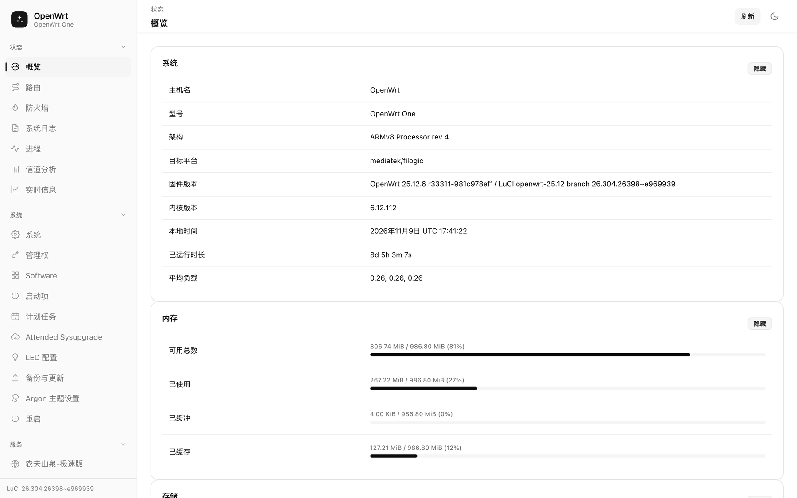

---

## 目录

- [简介](#简介)
- [效果图](#效果图)
- [特性](#特性)
- [安装教程](#安装教程)
  - [前置条件](#前置条件)
  - [方式一：一键安装包（推荐）](#方式一一键安装包推荐)
  - [方式二：apk 包（OpenWrt 24.10+）](#方式二apk-包openwrt-2410)
  - [方式三：手动部署](#方式三手动部署)
  - [切换、回退与卸载](#切换回退与卸载)
  - [排错](#排错)
- [AI 工具一键安装](#ai-工具一键安装)
- [开发](#开发)
  - [给 AI 工具的仓库说明](#给-ai-工具的仓库说明)
- [目录结构](#目录结构)
- [自定义配色](#自定义配色)
- [友链](#友链)
- [版权与许可](#版权与许可)

---

## 简介

`luci-theme-beautiful` 是一套受 [shadcn/ui](https://ui.shadcn.com) 启发的 OpenWrt **LuCI** 主题：克制的灰阶色板、充足的留白、常驻侧边栏，以及一键切换的明暗配色。

主题构建在官方 `luci-theme-bootstrap` 的**结构层**之上，因此所有 LuCI 控件的原始行为（下拉框、动态列表、标签页组、弹窗、指示灯）完全保留——它只替换外观，不改动任何功能逻辑。

- 无需联网加载字体或图标，断网环境同样完整可用
- 纯 CSS + 少量原生 JS，无构建产物依赖、无第三方运行时
- 已在 **OpenWrt 25.12 / LuCI 26.304** 实机验证；23.05 及以上使用 ucode 模板的 LuCI 结构一致

## 效果图

全部截图取自真机（OpenWrt One，ARMv8），非设计稿。

### 桌面端

| 状态 · 概览（浅色） | 状态 · 概览（深色） |
| :---: | :---: |
|  | 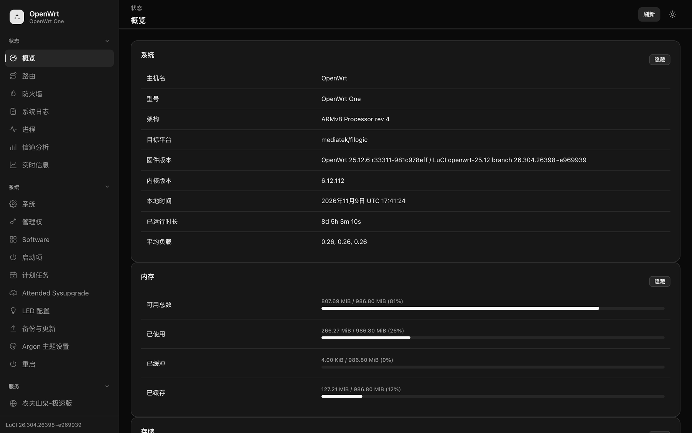 |

| 系统 · 设置（浅色） | 系统 · 设置（深色） |
| :---: | :---: |
| 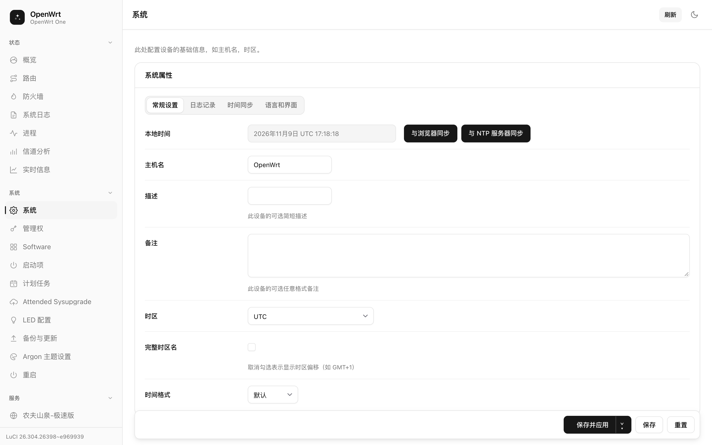 | 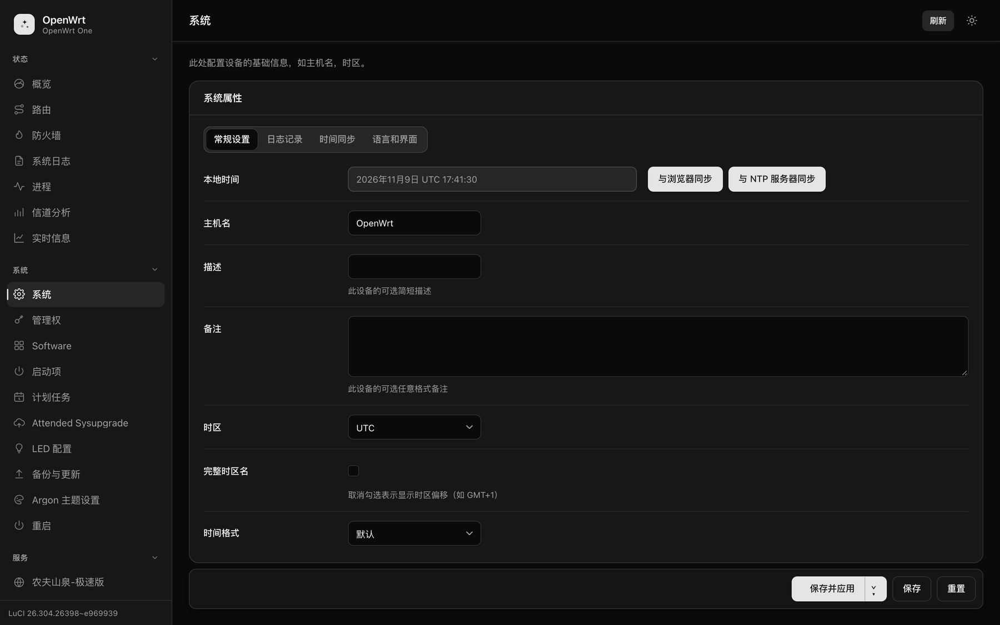 |

| 系统日志（浅色） | 系统日志（深色） |
| :---: | :---: |
| 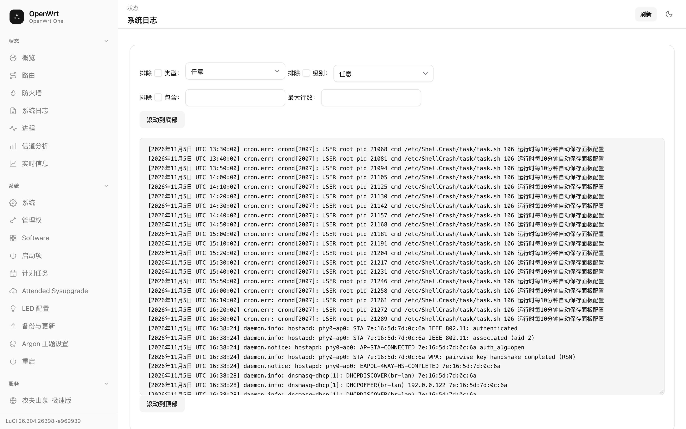 | 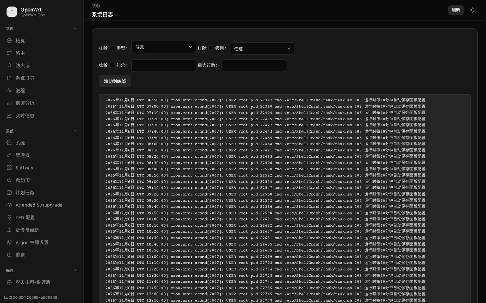 |

### 登录页

| 浅色 | 深色 |
| :---: | :---: |
| 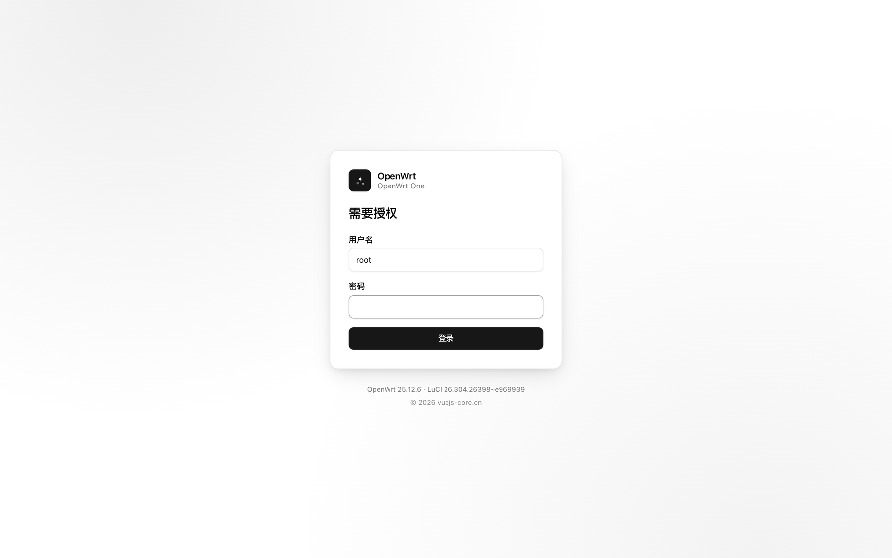 | 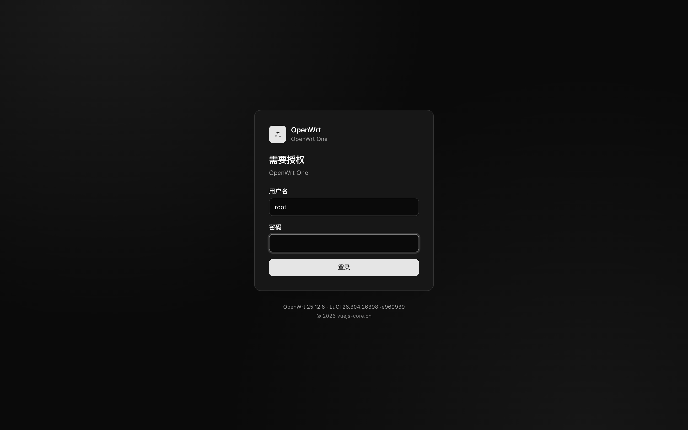 |

### 表格、危险操作与页脚

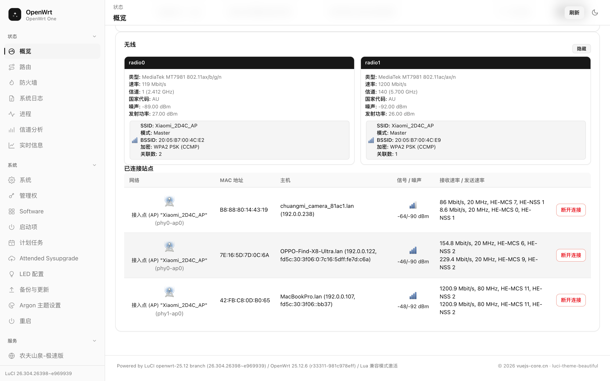

### 移动端

| 概览 | 抽屉菜单 |
| :---: | :---: |
| 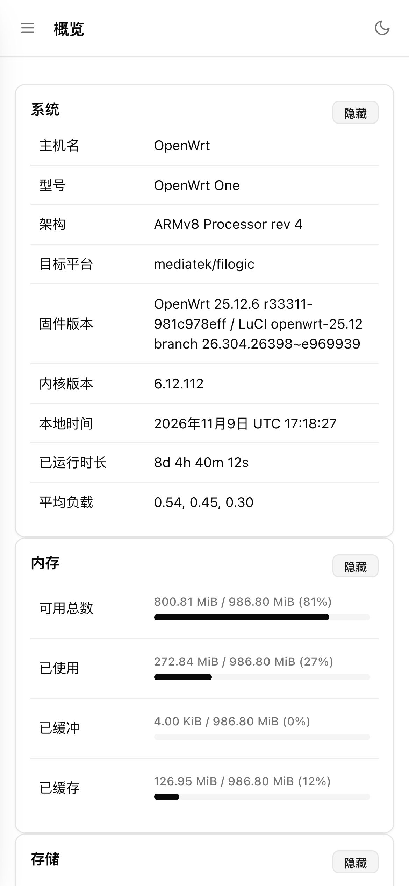 | 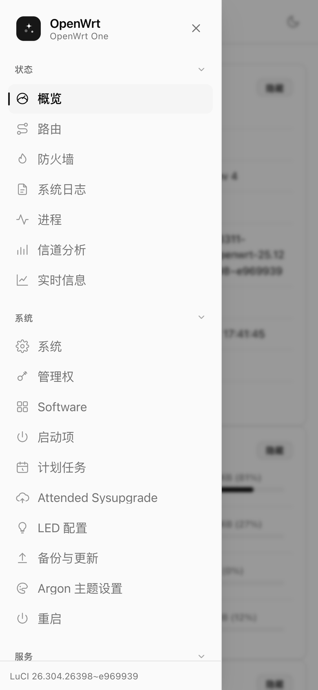 |

| 浅色 | 深色 |
| :---: | :---: |
| 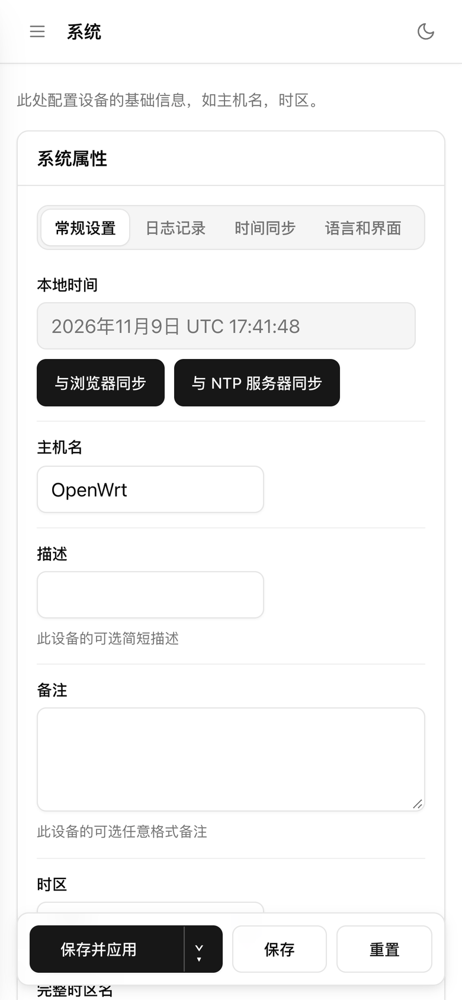 | 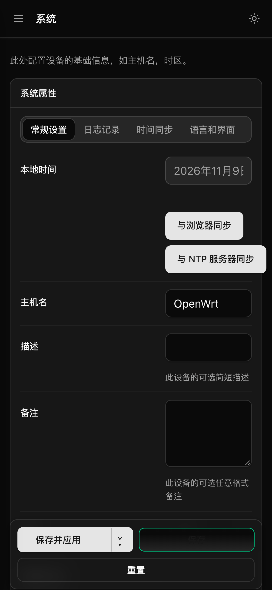 |

## 特性

- **shadcn 设计令牌** — 完整的 `--background / --foreground / --card / --primary …` 变量集，以 `oklch()` 定义，再映射到 LuCI 历史上使用的 `--*-color-*` 变量，因此主题与控件实现解耦。
- **侧边栏外壳** — 可折叠的导航分组，24×24 线性图标；顶部栏含面包屑、页面标题、指示灯与配色切换按钮（写入 `localStorage`，未设置时回落到 `prefers-color-scheme`）。
- **应用化组件** — 卡片、分段式标签页、克制的描边按钮、危险操作样式、浮动操作条、进度条、徽章、提示条、对话框。
- **移动端适配** — 窄屏自动收起为抽屉式导航，表格横向滚动，触控目标 ≥ 40px。
- **零 Web 字体** — 使用系统 UI 字体栈，加载快、离线可用，不产生任何外部请求。
- **可覆盖** — 改一处 `--primary` 即可换主色，无需重写选择器。

## 安装教程

### 前置条件

| 项目 | 要求 |
| --- | --- |
| 系统 | OpenWrt 23.05 / 24.10 / 25.x（LuCI 使用 ucode 模板） |
| 权限 | `root`，SSH 可登录（默认 `ssh root@192.168.1.1`） |
| 空间 | 约 200 KiB（`cascade.css` 约 150 KiB） |
| 联网 | 方式一需要路由器能访问 GitHub；否则用电脑下载后 `scp` 上传 |
| 备份 | 建议先备份 `/etc/config/luci`：`cp /etc/config/luci /etc/config/luci.bak` |

> 下文用 `192.168.1.1` 作为示例地址，请替换为你自己的路由器 IP。安装脚本不会重启路由器，也不需要重启。

### 方式一：一键安装包（推荐）

适用于所有版本，不需要 opkg/apk，不需要编译环境。

**第 1 步：把安装包放到路由器的 `/tmp`**

在路由器上直接下载（需要外网）：

```sh
wget -O /tmp/theme.tar.gz https://github.com/zxwk1998/luci-theme-beautiful/releases/latest/download/luci-theme-beautiful-1.0.0.tar.gz
```

或在电脑上下载后传上去：

```sh
scp luci-theme-beautiful-1.0.0.tar.gz root@192.168.1.1:/tmp/
```

**第 2 步：解包并执行安装脚本**

```sh
ssh root@192.168.1.1
cd /tmp && tar xzf theme.tar.gz
cd luci-theme-beautiful-1.0.0 && sh install.sh
```

脚本会依次完成四件事（可在 `root/install.sh` 中逐行核对）：

1. 复制 `cascade.css` / `mobile.css` / `logo.svg` 到 `/www/luci-static/beautiful/`
2. 复制 `menu-beautiful.js` 到 `/www/luci-static/resources/`，主题模板到 `/usr/share/ucode/luci/template/themes/beautiful/`
3. 写入 UCI：`luci.themes.Beautiful=/luci-static/beautiful` 与 `luci.main.mediaurlbase=/luci-static/beautiful`，然后 `uci commit luci`
4. 清理 `/tmp/luci-indexcache*` 并 `reload` uhttpd

**第 3 步：强制刷新浏览器**

打开 `http://192.168.1.1/cgi-bin/luci/`，按 `Ctrl/Cmd + Shift + R`。首次进入若仍是旧外观，属浏览器缓存，强制刷新即可。

### 方式二：apk 包（OpenWrt 24.10+）

`apk` 包必须由 OpenWrt 构建系统产出（仅 Linux）。把本目录放进 `feeds/luci/themes/` 后编译：

```sh
# 在 OpenWrt buildroot / SDK 内
./scripts/feeds update -a && ./scripts/feeds install -a
make package/luci-theme-beautiful/compile V=s
ls bin/packages/*/luci/luci-theme-beautiful-*.apk
```

仓库内的 `.github/workflows/build-apk.yml` 在 CI 上做同样的事，并上传产物。

安装：

```sh
scp luci-theme-beautiful-*.apk root@192.168.1.1:/tmp/
ssh root@192.168.1.1 'apk add --allow-untrusted /tmp/luci-theme-beautiful-*.apk'
```

> 路由器只接受由 `/etc/apk/keys` 中公钥签名的包。本地编译的包由该 SDK 的构建密钥签名；若要公开发布，请随包一并发布对应公钥，或用 `--allow-untrusted` 显式安装。
>
> 通过 apk 安装时，主题注册由 `root/etc/uci-defaults/30_luci-theme-beautiful` 完成，且遵循"不覆盖用户已有选择"的原则。

### 方式三：手动部署

不想执行脚本时，可以逐条执行等价操作：

```sh
mkdir -p /www/luci-static/beautiful \
         /www/luci-static/resources \
         /usr/share/ucode/luci/template/themes/beautiful

# 把解包出来的文件分别复制到上面三个目录
cp -f www/luci-static/beautiful/*              /www/luci-static/beautiful/
cp -f www/luci-static/resources/menu-beautiful.js /www/luci-static/resources/
cp -f usr/share/ucode/luci/template/themes/beautiful/*.ut \
      /usr/share/ucode/luci/template/themes/beautiful/
chmod 644 /www/luci-static/beautiful/* \
          /www/luci-static/resources/menu-beautiful.js \
          /usr/share/ucode/luci/template/themes/beautiful/*

uci set luci.themes.Beautiful=/luci-static/beautiful
uci set luci.main.mediaurlbase=/luci-static/beautiful
uci commit luci

rm -f /tmp/luci-indexcache*
/etc/init.d/uhttpd reload
```

### 切换、回退与卸载

**切换主题**：LuCI → *系统 → 系统 → 语言和界面*，在主题下拉框里选择 `Beautiful`。

**临时回退**（保留文件，只切回官方主题）：

```sh
uci set luci.main.mediaurlbase=/luci-static/bootstrap
uci commit luci
rm -f /tmp/luci-indexcache* && /etc/init.d/uhttpd reload
```

**完全卸载**：

```sh
uci set luci.main.mediaurlbase=/luci-static/bootstrap
uci delete luci.themes.Beautiful
uci commit luci

rm -rf /www/luci-static/beautiful
rm -f  /www/luci-static/resources/menu-beautiful.js
rm -rf /usr/share/ucode/luci/template/themes/beautiful

rm -f /tmp/luci-indexcache* && /etc/init.d/uhttpd reload
```

### 排错

| 现象 | 原因与处理 |
| --- | --- |
| 页面变成无样式纯文本 | `mediaurlbase` 未指到主题目录，或 `cascade.css` 没落地。检查 `uci get luci.main.mediaurlbase` 与 `ls -l /www/luci-static/beautiful/` |
| 外观变了但左侧菜单缺失 | `menu-beautiful.js` 没复制到 `/www/luci-static/resources/` |
| 仍是旧外观 | 浏览器缓存或 `/tmp/luci-indexcache*` 未清；强制刷新，或重跑第 4 步 |
| `cascade.css` 404 | 目录大小写不一致，Linux 区分大小写 |
| 安装脚本报 `must run as root` | 用 `root` 登录，而不是 `sudo sh`（`sudo` 未安装时同样报错） |
| 升级固件后主题消失 | 主题文件位于 `/www` 与 `/usr/share`，固件升级会重置；重新执行方式一即可 |

## AI 工具一键安装

不喜欢敲命令的话，可以把安装交给能执行本地命令的 AI 助手（Claude Code、Cursor、Codex、WorkBuddy 等），由它完成下载、上传、执行与校验。

### 完整版提示词（推荐）

复制下面整段，只改前几行的 IP 与密码：

```text
你是 OpenWrt 运维助手。请帮我在这台路由器上安装 luci-theme-beautiful 主题。

目标设备：
- IP：192.168.1.1
- 用户名：root
- 密码：在这里填密码（若无法免密登录，请先让我执行 ssh-copy-id）
- 系统：OpenWrt，具体版本你自行探测

请严格按步骤执行，任何一步失败就停下来报告原因，不要跳过、不要猜：

1. 探测环境
   ssh root@192.168.1.1 'cat /etc/openwrt_release; uci get luci.main.mediaurlbase'
   记录发行版与当前主题，确认这是 OpenWrt 而非其他 Linux。

2. 获取安装包（按顺序尝试）
   a) 优先从 release 下载：
      ssh root@192.168.1.1 'wget -O /tmp/theme.tar.gz https://github.com/zxwk1998/luci-theme-beautiful/releases/latest/download/luci-theme-beautiful-1.0.0.tar.gz'
   b) 若路由器不能访问外网，则在本地下载后上传：
      scp luci-theme-beautiful-1.0.0.tar.gz root@192.168.1.1:/tmp/theme.tar.gz
   c) 若 releases 中没有该文件，则本地打包后上传：
      git clone https://github.com/zxwk1998/luci-theme-beautiful.git
      cd luci-theme-beautiful && sh tools/package.sh
      scp dist/luci-theme-beautiful-*.tar.gz root@192.168.1.1:/tmp/theme.tar.gz

3. 安装
   ssh root@192.168.1.1 'cd /tmp && tar xzf theme.tar.gz && sh luci-theme-beautiful-*/install.sh'

4. 校验
   ssh root@192.168.1.1 'uci get luci.main.mediaurlbase; ls -l /www/luci-static/beautiful/cascade.css'
   期望输出：/luci-static/beautiful 且 cascade.css 存在。

5. 汇报
   告诉我访问地址 http://192.168.1.1/cgi-bin/luci/，并提醒我做一次强制刷新（Ctrl/Cmd+Shift+R）。

安全约束：
- 不要重启路由器，不要执行 reboot。
- 不要修改 /etc/config/network、/etc/config/wireless、防火墙规则。
- 不要卸载或覆盖其他已安装主题（luci-theme-bootstrap / argon 等）。
- 执行 rm、uci commit、reload uhttpd 之前，先用一句话说明它将做什么。
```

### 极简版提示词

上下文有限时，用这一句也够：

```text
帮我在 OpenWrt 路由器（root@192.168.1.1）上安装 https://github.com/zxwk1998/luci-theme-beautiful 。
取 releases 里的 luci-theme-beautiful-1.0.0.tar.gz，传到 /tmp 后执行包内 install.sh，
最后用 uci get luci.main.mediaurlbase 校验并告诉我访问地址。不要重启路由器。
```

### 验收清单

装完后确认这四项，即可判定成功：

- [ ] `uci get luci.main.mediaurlbase` 输出 `/luci-static/beautiful`
- [ ] 登录页为居中的卡片式布局，底部有版本号与版权信息
- [ ] 左侧导航为可折叠分组，右上角配色按钮可切换明暗且刷新后保持
- [ ] `系统 → 系统` 页面的分段标签页、开关、下拉框样式正常，功能可用

### 给 AI 工具的仓库说明

安装之外，如果你想让 AI 直接改这个主题（换配色、加组件、修某个 LuCI 页面），请让它先读 [`AGENTS.md`](AGENTS.md)。那份文件写的是「怎么在这个仓库里干活」：

- 分层规则：`src/` 是唯一来源，`cascade.css` 是产物；令牌集中在 `10-tokens.css`
- 硬约束：禁止页面级选择器、禁止写死尺寸、禁止模板内联样式，`npm run lint` 会直接失败
- LuCI 的坑：模块允许顶层 `return`、菜单必须用 `ui.menu.getChildren()` 过滤、视图渲染在 `#view`
- 验收标准：`npm run lint` + `npm run build` + 明暗两模式、1280/480 两种宽度实机确认

一句话提示词：

```text
读 AGENTS.md，按其中的分层规则和「Definition of done」修改这个主题。
不要改 src/vendor/00-structure.css，不要手改 cascade.css。
改完跑 npm run lint 与 npm run build，再用 tools/deploy.sh 部署到 192.168.1.1，
在浅色/深色、1280px/480px 下各截一次图确认没有回归。
```

## 开发

```sh
npm run lint                  # 布局约束检查（见下）
node tools/build.mjs          # src/*.css -> htdocs/luci-static/beautiful/cascade.css
tools/package.sh              # dist/luci-theme-beautiful-<version>.tar.gz
tools/deploy.sh <host> <pass> # 构建 + 推送到真机预览
```

`src/vendor/00-structure.css` 是未改动的 bootstrap 样式表（Apache-2.0），承载 LuCI 控件依赖的功能性规则；所有视觉样式都在它之上的编号分层里。

构建会把内容哈希写进 `header.ut` 的 `assetver`，因此部署后浏览器会立刻取到新样式，无需手动清缓存。

### 布局系统

基础布局只定义一次，所有页面共用；组件不硬编码尺寸，页面不允许自带样式。

- **`src/10-tokens.css`** 独占全部度量：`--space-*`、`--text-*`、`--control-h`、`--card-pad`、`--cell-pad-*`、`--field-cols`。响应式只切换令牌值，不再为每个组件重写一套断点规则。
- **组件层**（`30` 外壳 / `40` 控件 / `50` 表面 / `60` LuCI 组件）只消费令牌。卡片标题栏出血、表格出血、底部操作条都由 `--card-pad` 推导，改一处 padding 即可全局生效。
- **表单行**是一套两列网格：标签列 + 字段列，描述跨字段列。LuCI 的 `.cbi-value-description` 是 `.cbi-value-field` 的兄弟节点，因此必须显式指定列，不能交给自动排布。
- **`npm run lint`** 在以下情况直接失败：出现 `[data-page="…"]` 页面级选择器、页面专属 `#id`、写死的字号，或模板里出现内联布局样式。

需要调整某个页面时，改令牌或改组件，不要改页面。

## 目录结构

```
htdocs/luci-static/beautiful/        cascade.css, mobile.css, logo.svg
htdocs/luci-static/resources/        menu-beautiful.js
ucode/template/themes/beautiful/     header.ut, footer.ut, sysauth.ut
root/install.sh                      设备端安装脚本
root/etc/uci-defaults/               主题注册（包安装时使用）
src/                                 设计令牌 + 组件分层
src/vendor/00-structure.css          未改动的 bootstrap 结构层
tools/                               build.mjs, package.sh, deploy.sh
docs/screenshots/                    README 使用的实机截图
```

## 自定义配色

覆盖设计令牌即可，无需改选择器：

```css
:root {
	--primary: oklch(0.55 0.18 255);
	--primary-foreground: oklch(0.985 0 0);
	--radius: 0.75rem;
}
```

改完跑一次 `node tools/build.mjs`，再按「方式一」的第 2–3 步部署即可。

## 友链

| 项目 | 简介 |
| --- | --- |
| [**天天养基记账本**](https://niulai.vuejs-core.cn) | 基金持仓记账 App。多平台持仓合并成一张总账，买卖自动记账，收盘净值与涨跌排行，QDII 含美量一目了然。支持 Android、网页版 / PWA 与浏览器插件，红涨绿跌，基础功能永久免费。 |
| [**vue-admin-better**](https://github.com/zxwk1998/vue-admin-better) | 开源免费的 Vue 中后台管理系统框架，开箱可用。 |
| [**vuejs-core.cn**](https://vuejs-core.cn) | 作者站点，前端与工具类文章、项目索引。 |
| [**OpenWrt / LuCI**](https://github.com/openwrt/luci) | 本主题所服务的上游项目。 |

## 版权与许可

Copyright © 2026 [vuejs-core.cn](https://vuejs-core.cn). 保留所有权利。

本项目以 **Apache License 2.0** 授权发布，全文见 [LICENSE](LICENSE)，第三方归属声明见 [NOTICE](NOTICE)。

- 结构层 `src/vendor/00-structure.css` 取自 `luci-theme-bootstrap`，Copyright 2008-2022 The LuCI team，同样以 Apache-2.0 授权。
- 分发时必须保留 `LICENSE` 与 `NOTICE`，并在修改过的文件中注明改动。
- OpenWrt 与 LuCI 为其各自所有者的商标；本项目为独立的非官方作品，未获 OpenWrt 项目背书。

<div align="center">
<sub>如果这个主题让你的路由器好看了一点，欢迎 Star ⭐</sub>
</div>
